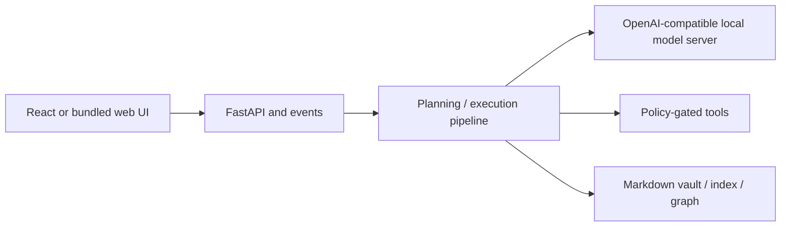

# Implementation and validation boundaries

JARVIS is an experimental local assistant, not a deployed autonomous service. The backend API can invoke file and shell tools and has no authentication; keep it on loopback as described in the root README.

Core tests exercise fake model responses, pipeline argument handling, memory, and tool behavior without a live model. A successful React build validates packaging, not desktop automation, speech, or model quality. Windows control, downloaded speech/embedding models, and live-model workflows require separate validation.

The existing CI already covers backend tests, UI builds, and history scanning. It is retained rather than replaced. Historical plans remain proposals unless supported by implementation. See [portfolio case study](https://hijaz.dev/applied-ai/jarvis/) for context and [security guidance](../SECURITY.md) before use.
